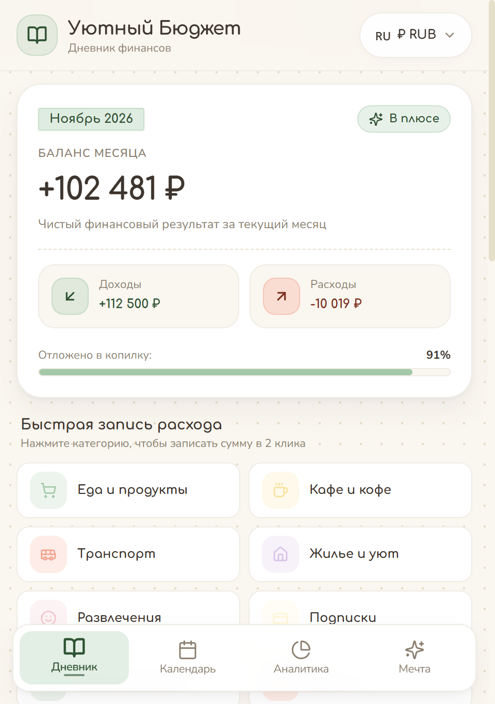
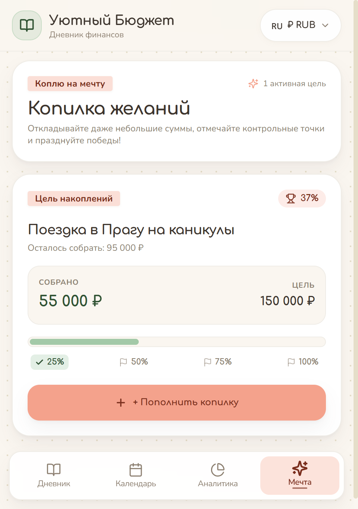
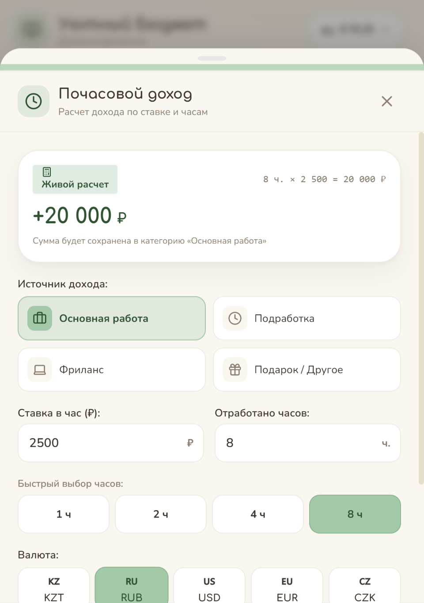
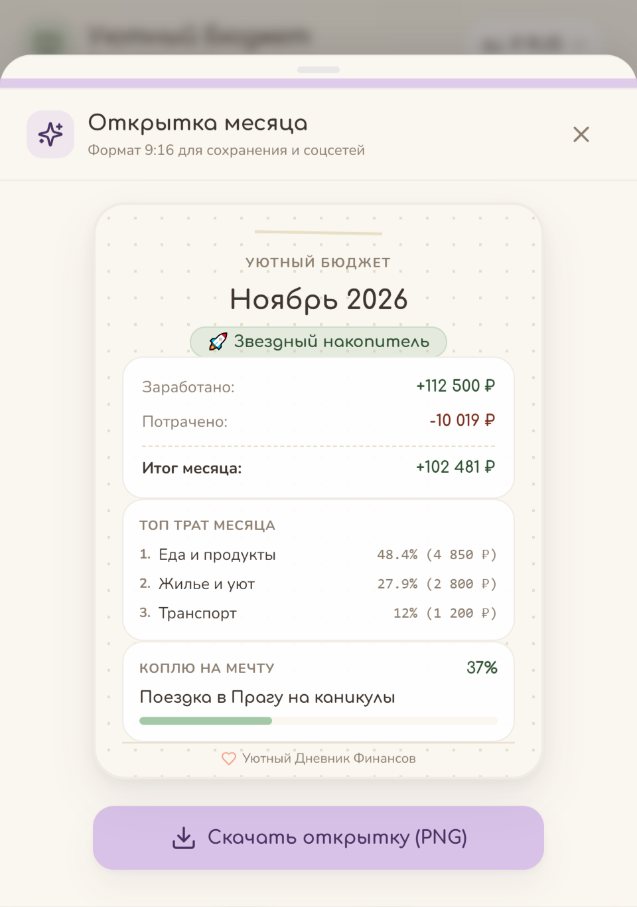
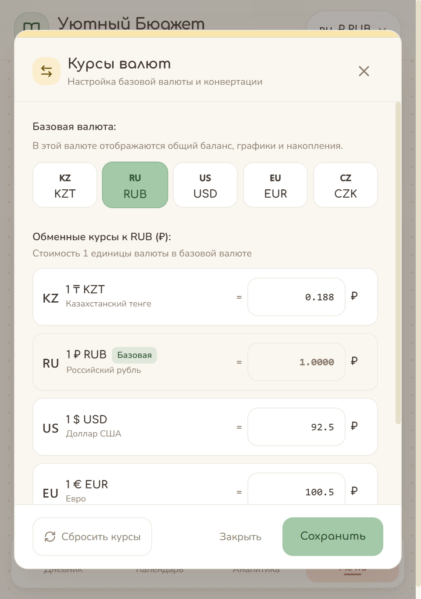

<div align="center">


# 📔 Paper Vault · Уютный Бюджет

<a href="#">
  
</a>

<p align="center">
  <i>Уютный персональный финансовый планер в стиле тактильного bullet-journal с живой физикой, калькулятором дохода и настенным календарем платежей</i>
</p>

### 🌸 Быстрое скачивание для Windows (1 клик)

<p align="center">
  <a href="https://github.com/GL1NoMe5/paper-vault/releases/download/v1.0.0/Paper-Vault-Setup-1.0.0.exe">
    
  </a>
  &nbsp;&nbsp;
  <a href="https://github.com/GL1NoMe5/paper-vault/releases/download/v1.0.0/Paper-Vault-Portable-1.0.0.exe">
    
  </a>
</p>

> 💡 **Как запустить за 10 секунд:**
> 1. Нажми на кнопку **«🌸 Скачать Установщик»** выше
> 2. Открой скачанный файл в браузере (если Windows напишет *«Защитник защитил ваш ПК»* — нажми *«Подробнее»* ➔ *«Выполнить в любом случае»*)
> 3. Готово! Приложение запустится и создаст уютный ярлычок на рабочем столе ✨

<br/>

[](https://react.dev/)
[](https://www.typescriptlang.org/)
[](https://vitejs.dev/)
[](https://tailwindcss.com/)
[](https://motion.dev/)
[-41B883?style=for-the-badge&logo=vitest&logoColor=white)](https://vitest.dev/)
[](https://github.com/GL1NoMe5/paper-vault/releases/latest)
[](#-быстрый-запуск-для-windows)
[](LICENSE)

<br/>

**[🖼️ Галерея](#-галерея-интерфейса)** &nbsp;•&nbsp; **[✨ Возможности](#-возможности)** &nbsp;•&nbsp; **[🎨 Дизайн-концепт](#-дизайн-концепт-bullet-journal)** &nbsp;•&nbsp; **[🚀 Быстрый запуск](#-быстрый-запуск-для-windows)** &nbsp;•&nbsp; **[💻 Разработка](#-разработка-и-сборка)** &nbsp;•&nbsp; **[📁 Структура](#-структура-проекта)** &nbsp;•&nbsp; **[🧪 Тесты](#-верификация-и-метрики-качества)** &nbsp;•&nbsp; **[❓ FAQ](#-частые-вопросы-faq)**

</div>

<br/>

---

## 🖼️ Галерея интерфейса

<div align="center">

<table>
<tr>
  <td align="center" width="25%" valign="top">
    <b>📔 1. Дневник</b><br/><br/>
    <a href="docs/screenshots/01-journal.png">
      
    </a>
    <br/><br/>
    <sub>Баланс месяца, быстрые чипы расходов и недавние записи</sub>
  </td>
  <td align="center" width="25%" valign="top">
    <b>📅 2. Календарь</b><br/><br/>
    <a href="docs/screenshots/03-calendar.png">
      
    </a>
    <br/><br/>
    <sub>Настенный планер списаний со стикерами и алертом за 5 дней</sub>
  </td>
  <td align="center" width="25%" valign="top">
    <b>📊 3. Аналитика</b><br/><br/>
    <a href="docs/screenshots/04-analytics.png">
      
    </a>
    <br/><br/>
    <sub>Recharts пончик-диаграмма трат и советник на желтом стикере</sub>
  </td>
  <td align="center" width="25%" valign="top">
    <b>🎯 4. Мечта</b><br/><br/>
    <a href="docs/screenshots/06-goals.png">
      
    </a>
    <br/><br/>
    <sub>Трекер целей, контрольные флажки и быстрые пополнения</sub>
  </td>
</tr>
</table>

</div>

<br/>

---

## 📖 Что такое Paper Vault?

**Paper Vault (Уютный Бюджет)** — это вдохновляющий личный финансовый дневник, созданный как антитеза сухим банковским таблицам и корпоративным интерфейсам. Мы перенесли теплоту настоящей крафтовой бумаги, стикеров-напоминалок и разноцветных маркеров в современное desktop-приложение с плавной физикой анимаций.

Приложение полностью автономно, не требует серверов, регистраций или подписок: все ваши данные бережно сохраняются исключительно на вашем компьютере.

<br/>

## 🎨 Дизайн-концепт: Bullet-Journal

Интерфейс спроектирован по принципам физического блокнота для записей:

* **Фон плотной бумаги** (`#FAF6F0`) с деликатной точечной разметкой (`#E5DEC9`), создающей ощущение страниц блокнота Leuchtturm1917 / Moleskine.
* **Карточки-страницы** (`#FFFFFF` и `#FDFBF7`) с теплыми микро-границами (`1px solid #EFECE6`) и мягкими рассеянными тенями (`0 8px 20px -4px rgba(139, 115, 85, 0.08)`).
* **Теплая графитовая типографика** (`#3D352E`) вместо резкого черного цвета в сочетании с пастельным таупом (`#8C7F70`).
* **Пастельные маркеры-хайлайтеры**:
  * 🌿 *Шалфейный зеленый* (`#A3C9A8` / `#2F5233`) — доходы и накопления
  * 🍑 *Терракотовый коралл* (`#F4A28C` / `#7A2E1D`) — расходы и списания
  * 🍯 *Масляный желтый* (`#F9E29C` / `#6E5611`) — предупреждения и стикеры-советы
  * 🪻 *Лавандовый* (`#D8C2E8`) — регулярные счета и подписки
  * 🌸 *Чайная роза* (`#F2C6CE`) — цели и мечта

<br/>

---

## ✨ Возможности

### 📔 Дневник расходов и Калькулятор дохода

<table>
<tr>
<td width="55%" valign="top">

* **Запись расходов в 2 клика**: мгновенный выбор чипа категории и ввод суммы без лишних экранов.
* **8 базовых + кастомные категории**: создавайте свои персональные категории со стикерами и иконками.
* **Калькулятор почасового дохода**: удобная шторка с живым расчетом `ставка в час` × `отработанные часы` = `доход` и пресетами (1ч, 2ч, 4ч, 8ч). Детали расчета автоматически сохраняются в историю.
* **Живые цифры**: плавная смена балансов благодаря анимациям `@number-flow/react`.
* **Умная лента записей**: группировка по «Сегодня», «Вчера» и календарным датам с возможностью быстрого удаления.

</td>
<td width="45%" align="center" valign="middle">

<a href="docs/screenshots/02-hourly-calculator.png">
  
</a>
<br/>
<sub><i>Шторка Vaul: живой расчет почасового дохода (ставка × часы)</i></sub>

</td>
</tr>
</table>

<br/>

### 📅 Календарь-планер регулярных счетов

<table>
<tr>
<td width="45%" align="center" valign="middle">

<a href="docs/screenshots/03-calendar.png">
  
</a>
<br/>
<sub><i>Настенный планер месяца с цветными стикерами платежей</i></sub>

</td>
<td width="55%" valign="top">

* **Настенный планер**: интерактивная сетка месяца в стиле крафтового календаря с отметками регулярных счетов цветными стикерами.
* **Баннер «Скоро списание»**: автоматическое напоминание о предстоящих платежах за ближайшие 5 дней.
* **Счетчик остатка**: наглядный расчет суммы, оставшейся к оплате в текущем месяце.
* **Оплата в 1 клик**: кнопка «Оплачено» мгновенно формирует расходную проводку в журнале и обновляет статус счета.
* **Добавление подписок**: гибкая настройка дня месяца, суммы, валюты и категории.

</td>
</tr>
</table>

<br/>

### 📊 Аналитика, Умный советник и Открытка месяца

<table>
<tr>
<td width="55%" valign="top">

* **Пончик-диаграмма Recharts**: визуальное процентное распределение трат по категориям с пастельными цветами маркеров.
* **Шкала «Заработано vs Потрачено»**: наглядное соотношение доходов и расходов за текущий месяц и доля отложенного в копилку.
* **Динамический умный советник**: стикер-заметка (`#FFF6D6`), прикрепленный скотчем, тактично подсказывает, где можно сэкономить (доля кофе, переплаты за подписки, норма сбережений).
* **Экспорт открытки месяца (9:16 PNG)**: генерация эстетичной сторис-открытки `itogi-mesyaca.png` в высоком разрешении для сохранения на память.

</td>
<td width="45%" align="center" valign="middle">

<a href="docs/screenshots/05-monthly-story.png">
  
</a>
<br/>
<sub><i>Предпросмотр эстетичной 9:16 открытки месяца для соцсетей</i></sub>

</td>
</tr>
</table>

<br/>

### 🎯 Коплю на мечту & 💱 Мультивалютный движок

<table>
<tr>
<td width="45%" align="center" valign="middle">

<a href="docs/screenshots/07-currency-modal.png">
  
</a>
<br/>
<sub><i>Справочник и редактор обменных курсов 5 мировых валют</i></sub>

</td>
<td width="55%" valign="top">

* **Визуальный трекер цели**: прогресс-бар с контрольными точками (25%, 50%, 75%, 100%), оставшейся суммой и вдохновляющим статусом.
* **Быстрое пополнение копилки**: мгновенные депозиты в один клик с автоматическим обновлением прогресса.
* **Праздничные салюты**: взрыв разноцветного конфетти (`canvas-confetti`) при преодолении ключевых отметок.
* **5 мировых валют**: тенге (`₸ KZT`), рубли (`₽ RUB`), доллары (`$ USD`), евро (`€ EUR`) и чешские кроны (`Kč CZK`).
* **Кастомный редактор курсов**: возможность задавать собственные валютные курсы прямо в интерфейсе с автоматическим пересчетом всех балансов.

</td>
</tr>
</table>

<br/>

---

## 🗺️ Как это устроено

<div align="center">

| 1. 📝 Быстрая запись | 2. 🗓️ Контроль дат | 3. 📈 Анализ и советы | 4. 🎉 Мечта и финиш |
|:---:|:---:|:---:|:---:|
| Записывайте расходы в 2 клика или считайте смену через `ставка × часы` | Планируйте подписки на настенном календаре без забытых платежей | Изучайте диаграммы и читайте советы умного стикера | Пополняйте копилку и празднуйте цели под дождь из конфетти |

</div>

<br/>

---

## 🚀 Быстрый запуск для Windows

Вы можете запустить **Paper Vault** любым удобным способом — без консольных окон и сложных настроек:

### Способ 1: Прямая загрузка релизных бинарников (Рекомендуется)
> Идеально для повседневного использования.

* 🌸 **[Скачать Установщик Windows (Setup .exe)](https://github.com/GL1NoMe5/paper-vault/releases/download/v1.0.0/Paper-Vault-Setup-1.0.0.exe)** — устанавливает приложение за 3 секунды и создает ярлык на Рабочем столе.
* 🎀 **[Скачать Портативную версию (Portable .exe)](https://github.com/GL1NoMe5/paper-vault/releases/download/v1.0.0/Paper-Vault-Portable-1.0.0.exe)** — запускается сразу без установки, можно носить на флешке.

### Способ 2: Запуск в 1 клик из корня репозитория
Если вы клонировали исходники проекта, в корне подготовлены скрипты быстрого старта:
* **`Запустить Уютный Бюджет (без консоли).vbs`** — запускает приложение абсолютно бесшумно, без черного окна командной строки.
* **`Запустить.bat`** (или `Запустить Уютный Бюджет.bat`) — быстрый командный файл для автоматического поиска собранного exe или запуска в dev-режиме.

<br/>

---

## 💻 Разработка и сборка

Если вы хотите модифицировать код, запустить локальный сервер разработки или собрать свежий дистрибутив:

### Системные требования
* **Node.js**: версии `18.0.0` или выше
* **npm**: версии `9.0.0` или выше

### Установка и запуск

```bash
# 1. Клонирование репозитория
git clone https://github.com/GL1NoMe5/paper-vault.git
cd paper-vault

# 2. Установка зависимостей
npm install

# 3. Запуск локального dev-сервера с горячей перезагрузкой (HMR)
npm run dev

# 4. Прогон всех модульных и E2E тестов
npm run test:run

# 5. Production-сборка веб-части
npm run build

# 6. Запуск в окне Electron для разработки
npm run electron:start

# 7. Автоматическое снятие скриншотов высокого разрешения
node scripts/capture-screenshots.cjs

# 8. Сборка Windows .exe (Portable + NSIS Setup Installer)
npm run dist
```

> 💡 После выполнения `npm run dist` готовые дистрибутивы будут ждать вас в директории `dist-electron/`.

<br/>

---

## 📁 Структура проекта

```text
paper-vault/
├── docs/                             # Документация и скриншоты интерфейса
│   └── screenshots/                  # Высококачественные PNG-скриншоты Retina 2x
│       ├── 01-journal.png            # Вкладка 1: Дневник и баланс
│       ├── 02-hourly-calculator.png  # Шторка: Почасовой доход (ставка × часы)
│       ├── 03-calendar.png           # Вкладка 2: Настенный календарь-планер
│       ├── 04-analytics.png          # Вкладка 3: Аналитика и стикер-советник
│       ├── 05-monthly-story.png      # Экспорт: 9:16 открытка месяца
│       ├── 06-goals.png              # Вкладка 4: Копилка на мечту
│       └── 07-currency-modal.png     # Окно: Курсы валют и конвертер
├── electron/                         # Главный процесс Electron
│   ├── main.cjs                      # Окно приложения, фрейм 480x860, иконка
│   └── preload.cjs                   # Безопасный контекстный мост
├── public/                           # Статические ресурсы
│   ├── icon.svg                      # Векторная иконка уютного блокнота
│   └── manifest.json                 # Конфигурация Web App Manifest
├── scripts/                          # Скрипты автоматизации
│   └── capture-screenshots.cjs       # Автоматический захват скриншотов через Electron
├── src/                              # Исходный код приложения
│   ├── components/                   # React-компоненты
│   │   ├── analytics/                # Tab 3: Recharts диаграммы, советы, 9:16 экспорт
│   │   ├── calendar/                 # Tab 2: Настенный календарь, подписки, алерты
│   │   ├── goals/                    # Tab 4: Копилка на мечту, взрыв конфетти
│   │   ├── journal/                  # Tab 1: Расходы в 2 клика, почасовой доход
│   │   ├── layout/                   # Шапка, валютный селектор, навигация
│   │   └── ui/                       # Базовые UI-примитивы (карточки, модалки)
│   ├── context/                      # React Context & LocalStorage синхронизация
│   ├── data/                         # Начальные демонстрационные данные
│   ├── test/                         # Комплексный набор тестов Vitest (197 тестов)
│   │   └── e2e/                      # Многоуровневые сценарии (Tier 1–4)
│   ├── types/                        # TypeScript интерфейсы и типы данных
│   ├── utils/                        # Валютный калькулятор, формулы, форматирование
│   ├── App.tsx                       # Корневой компонент
│   ├── index.css                     # Tailwind CSS, крафтовые текстуры и переменные
│   └── main.tsx                      # Входная точка приложения
├── .gitignore                        # Исключение тяжелых бинарников и node_modules
├── package.json                      # Зависимости и скрипты сборки
├── tailwind.config.js                # Токены крафтовой палитры и шрифтов
├── tsconfig.json                     # Конфигурация TypeScript
├── Запустить Уютный Бюджет (без консоли).vbs  # Бесшумный лаунчер Windows
└── Запустить.bat                     # Быстрый batch-запуск
```

<br/>

---

## 🧪 Верификация и метрики качества

Каждая функция проекта покрыта строгими автоматизированными тестами с акцентом на бизнес-логику, граничные случаи и сценарии реальных пользователей:

```text
 ✓ src/test/e2e/tier2_boundaries.test.ts (30 tests)
 ✓ src/test/currency.test.ts (33 tests)
 ✓ src/test/hourly.test.ts (24 tests)
 ✓ src/test/e2e/tier3_combinations.test.ts (8 tests)
 ✓ src/test/setup.test.ts (3 tests)
 ✓ src/test/e2e/tier1_features.test.ts (32 tests)
 ✓ src/test/e2e/tier4_scenarios.test.ts (5 tests)
 ✓ src/test/currencyModal.test.tsx (10 tests)
 ✓ src/test/layout.test.tsx (9 tests)
 ✓ src/test/goals.test.tsx (5 tests)
 ✓ src/test/calendar.test.tsx (8 tests)
 ✓ src/test/analytics.test.tsx (7 tests)
 ✓ src/test/journal.test.tsx (23 tests)

Test Files  13 passed (13)
     Tests  197 passed (197)
```

* **197 из 197 тестов (100%)** успешно проходят в CI/CD и локально.
* **0 ошибок типизации TypeScript** при строгом режиме проверки (`tsc -b`).
* **Глубокое E2E тестирование**:
  * **Tier 1**: Полный функциональный цикл всех 4 вкладок.
  * **Tier 2**: Граничные значения (минимальные/максимальные суммы, високосные года, переходы месяцев).
  * **Tier 3**: Комбинаторные сценарии (мультивалютные пересчеты подписок, смены базовой валюты).
  * **Tier 4**: Комплексные пользовательские флоу (год жизни бюджета, накопление на мечту).

<br/>

---

## ❓ Частые вопросы (FAQ)

<details>
<summary><b>🔒 Где хранятся мои финансовые данные?</b></summary>
<br/>
Все ваши записи, подписки и цели хранятся исключительно локально в браузере / приложении (через механизм <code>localStorage</code>). Ни единый байт информации не отправляется на сторонние серверы или в облако.
</details>

<details>
<summary><b>💱 Как настроить собственный курс валюты?</b></summary>
<br/>
Нажмите на значок базовой валюты в верхней шапке приложения. В открывшемся окне вы сможете выбрать отображаемую валюту, а также отредактировать курсы обмена вручную — все балансы мгновенно пересчитаются по вашему курсу.
</details>

<details>
<summary><b>💼 Как работает расчет почасового дохода?</b></summary>
<br/>
На вкладке «Дневник» нажмите кнопку «+ Почасовой доход». Укажите вашу часовую ставку и количество отработанных часов (например, за смену или проект). Система автоматически рассчитает итоговую сумму и добавит запись с понятным описанием (например: <i>«8 ч. × 2 500 = 20 000»</i>).
</details>

<details>
<summary><b>📸 В каком формате скачивается открытка месяца?</b></summary>
<br/>
Открытка месяца генерируется в формате высокого разрешения <b>9:16 PNG</b> (файл <code>itogi-mesyaca.png</code>), идеально подходящем для сохранения на память или публикации в соцсетях.
</details>

<details>
<summary><b>🐧 Можно ли собрать приложение под macOS или Linux?</b></summary>
<br/>
Да! Кодовая база полностью кроссплатформенна. Вы можете собрать бинарники под macOS (`dmg`) или Linux (`AppImage`/`deb`), запустив `npx electron-builder --mac` или `npx electron-builder --linux`.
</details>

<br/>

---

<div align="center">


### *«Уютный учет денег без стресса и суеты»*

Made with ☕ & ❤️ by **[GL1NoMe5](https://github.com/GL1NoMe5)**

[](https://github.com/GL1NoMe5/paper-vault)
[](https://github.com/GL1NoMe5/paper-vault)

Released under the **[MIT License](LICENSE)**.

</div>
